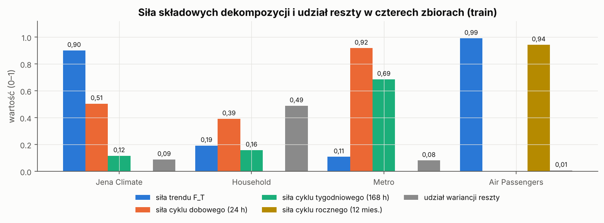
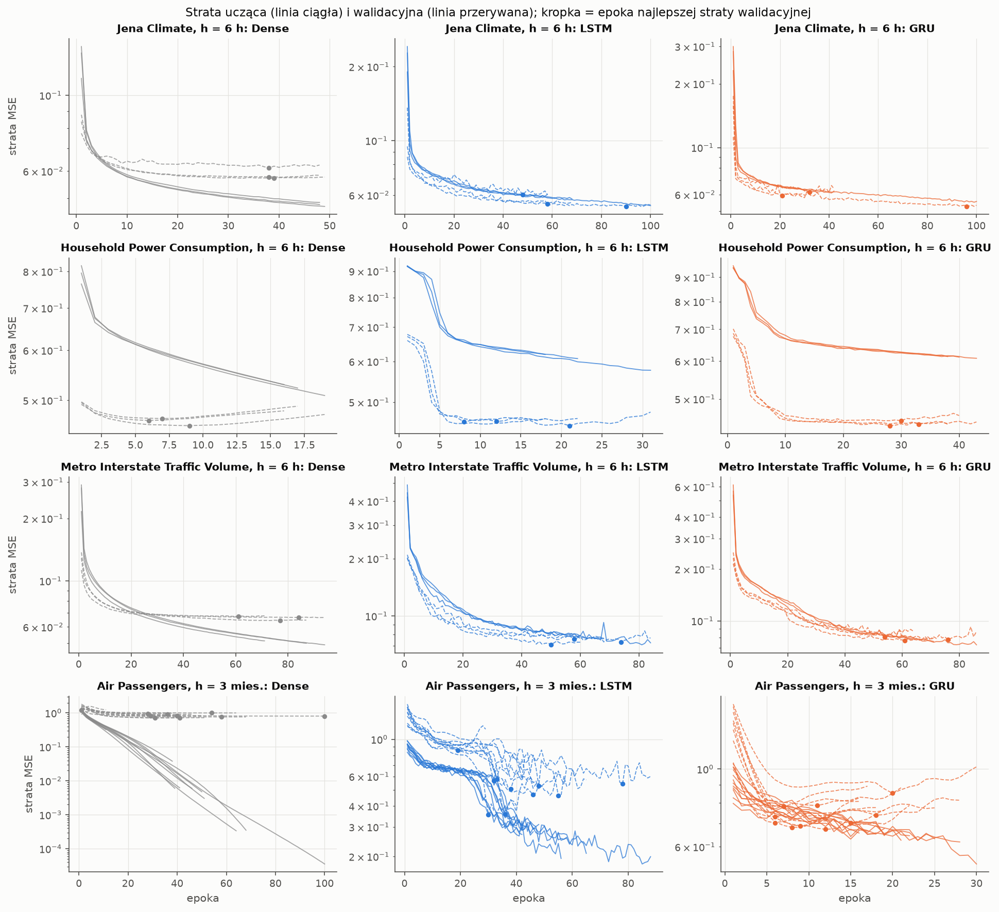
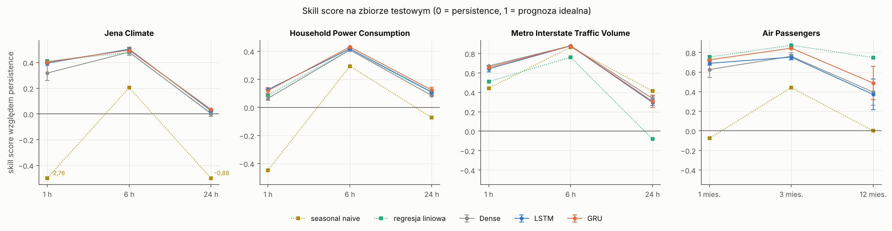
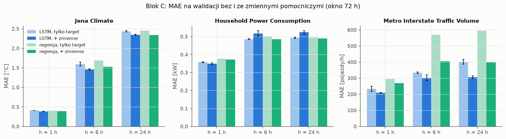
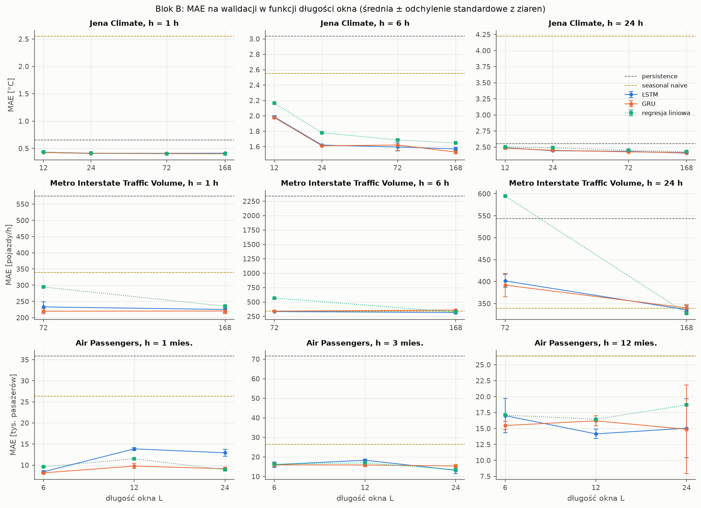
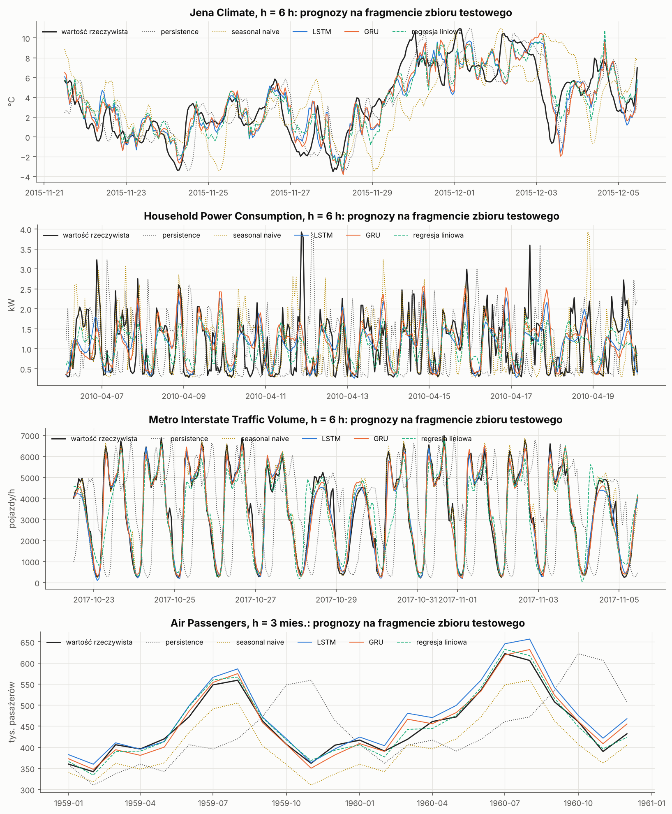
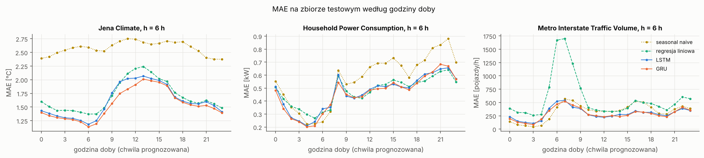
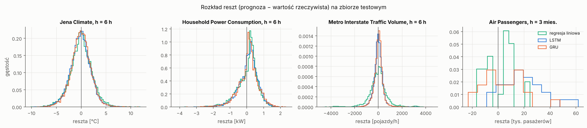

# Do LSTM and GRU networks really beat simple forecasts?

**A reproducible comparison of recurrent neural networks and strong baselines for time-series forecasting on four real-world datasets.**


LSTM and GRU networks are often presented as the default choice for time-series forecasting. This project tests that claim rigorously. We compare them with simple forecasts (persistence, seasonal naive), linear regression, a dense network and a temporal convolutional network (TCN) on four datasets with very different characteristics, at three forecast horizons each. All decisions were made on a validation set, and the test set was used **exactly once**, after all configurations had been frozen.

**Short answer:** recurrent networks clearly beat the best simple method in only **11 of 24** comparisons, all on long hourly series. The improvement is usually a few percent. On a short monthly series, plain linear regression wins. Better *inputs* (an input window covering the seasonal cycle, calendar features) mattered more than the choice of architecture.

> Deep Learning laboratory project (Project 2A), autumn 2026. The code, comments and notebooks are in Polish; this README summarises the project in English.

---

## Table of contents

- [Datasets](#datasets)
- [Models](#models)
- [Methodology](#methodology)
- [Experiments](#experiments)
- [Results](#results)
- [Hypotheses](#hypotheses)
- [Key takeaways](#key-takeaways)
- [Repository structure](#repository-structure)
- [How to reproduce](#how-to-reproduce)
- [Limitations](#limitations)
- [Authors](#authors)

---

## Datasets

| Dataset | Domain | Frequency | Target | Main difficulty |
| --- | --- | --- | --- | --- |
| [Jena Climate](https://www.bgc-jena.mpg.de/wetter/) 2009–2016 | weather | 1 h (from 10 min) | air temperature [°C] | slow level changes and weather fronts on top of a daily cycle; 14 auxiliary variables |
| [Household Power Consumption](https://archive.ics.uci.edu/dataset/235) 2006–2010 | energy | 1 h (from 1 min) | active power [kW] | very noisy: almost half of the variance comes from appliances switching on at random times |
| [Metro Interstate Traffic Volume](https://archive.ics.uci.edu/dataset/492) 2012–2018 | road traffic | 1 h | vehicles per hour | strong daily and weekly cycles, holidays, 22.8% missing hours |
| [Air Passengers](https://github.com/vincentarelbundock/Rdatasets) 1949–1960 | aviation | 1 month | passengers [thousands] | only 144 observations, strong trend, test values above the training range |

Forecast horizons: **1, 6 and 24 hours** for the hourly datasets and **1, 3 and 12 months** for Air Passengers. The raw files are downloaded automatically on first use.

Before training any model we analysed each dataset in detail: data quality, trend, seasonality (ACF, MSTL/STL decomposition, periodogram), stationarity tests, the predictive value of auxiliary variables and distribution shift between the splits. This analysis predicted most of the later results correctly.

<p align="center">
  
</p>
<p align="center"><em>Strength of the trend and seasonal components and the share of residual variance in each dataset (MSTL/STL on the training set). Household is the only dataset where the residual dominates.</em></p>

## Models

| Model | Type | Notes |
| --- | --- | --- |
| Persistence | no training | forecast = last known value |
| Seasonal naive | no training | forecast = value one season earlier (24 h or 168 h, 12 months) |
| Linear regression | least squares | same input window as the networks |
| Dense | feed-forward network | Flatten → 64 → 32 → 1 |
| **LSTM** | recurrent network | 64 units, dropout 0.2 (16 961 parameters) |
| **GRU** | recurrent network | 64 units, dropout 0.2 (12 929 parameters) |
| TCN | causal dilated convolutions | 5 residual blocks, dilations 1–16, 17 276 parameters (extension, Jena only) |

All networks are built by one function and share the output layer, loss (MSE), optimiser (Adam) and early stopping (patience 10, best weights restored), so that differences come from how each model processes the input window.

## Methodology

The project was designed to avoid the most common pitfalls in time-series evaluation:

- **Chronological 60/20/20 split**, never shuffled; for Air Passengers whole years (1949–56 / 1957–58 / 1959–60).
- **No information from the future**: scalers are fitted on the training set only; each window is assigned to a split by the time of its *target*; missing values are filled only forward (gaps ≤ 3 steps).
- **One common evaluation set**: within each (dataset, horizon) pair every model is evaluated on exactly the same time points, even when models use different window lengths.
- **Hypotheses and criteria fixed in advance**, before any experiment.
- **Several random seeds** for every network (3, or 10 for Air Passengers). A difference counts as *clear* only if it exceeds the standard deviation across seeds.
- **Frozen configurations and a single test run**: the best configurations were selected on validation and written to `final_configs.json`. The test evaluation refuses to run without explicit confirmation, will not overwrite the frozen file and refuses to run a second time.
- **Resumable experiments**: each training is identified by a hash of its configuration and saved atomically, so an interrupted run resumes without duplicates. This was needed in practice when the laptop shut down mid-experiment.
- **22 automated program tests** cover window construction, leakage, scaling, baselines, metrics, parameter counts, reproducibility with a fixed seed and the test-set lock.

## Experiments

640 trainings in five blocks, 21.8 h of training on a laptop CPU (no GPU):

| Block | Question | Trainings |
| --- | --- | --- |
| A | Dense vs LSTM vs GRU vs baselines under identical conditions (72 h / 24-month window, target history only) | 261 |
| B | Does the window length matter? (Jena 12–168 h, Metro 168 h, Air 6/12 months) | 313 |
| C | Do auxiliary variables help? (weather, electrical measurements, calendar features for the forecast time) | 27 |
| D | Do architecture changes help? (units, layers, dropout, learning rate) | 30 |
| E | Is recurrence necessary? (TCN on Jena Climate) | 9 |

<p align="center">
  
</p>
<p align="center"><em>Training (solid) and validation (dashed) loss in block A, one line pair per seed. Clear overfitting appears only on the tiny Air Passengers dataset, especially for the Dense network.</em></p>

## Results

### Test MAE under identical conditions (block A)

Mean ± standard deviation across seeds; **bold** = best in row.

| Dataset | h | Persistence | Seasonal naive | Linear reg. | Dense | LSTM | GRU |
| --- | --- | --- | --- | --- | --- | --- | --- |
| Jena [°C] | 1 h | 0.686 | 2.579 | **0.404** | 0.468 ± 0.040 | 0.415 ± 0.003 | 0.409 ± 0.002 |
| Jena | 6 h | 3.244 | 2.579 | 1.694 | 1.684 ± 0.086 | **1.608 ± 0.042** | 1.630 ± 0.073 |
| Jena | 24 h | 2.579 | 4.841 | 2.558 | 2.573 ± 0.058 | 2.511 ± 0.020 | **2.489 ± 0.006** |
| Household [kW] | 1 h | 0.392 | 0.567 | 0.358 | 0.367 ± 0.006 | **0.342 ± 0.001** | 0.345 ± 0.009 |
| Household | 6 h | 0.804 | 0.567 | 0.475 | 0.475 ± 0.007 | 0.468 ± 0.003 | **0.458 ± 0.001** |
| Household | 24 h | 0.530 | 0.568 | 0.474 | 0.485 ± 0.002 | 0.472 ± 0.003 | **0.464 ± 0.010** |
| Metro [veh/h] | 1 h | 589.7 | 328.6 | 289.0 | **193.6 ± 2.4** | 210.6 ± 18.1 | 202.0 ± 7.3 |
| Metro | 6 h | 2413.1 | 328.2 | 574.7 | **290.6 ± 4.5** | 293.8 ± 1.9 | 292.7 ± 14.9 |
| Metro | 24 h | 560.7 | **328.0** | 606.0 | 371.4 ± 12.7 | 394.5 ± 18.6 | 388.3 ± 35.2 |
| Air [thous.] | 1 mo | 44.2 | 47.6 | **10.8** | 16.5 ± 3.6 | 13.7 ± 0.8 | 12.1 ± 0.2 |
| Air | 3 mo | 85.3 | 47.6 | **10.7** | 20.3 ± 3.0 | 21.0 ± 2.2 | 13.2 ± 0.9 |
| Air | 12 mo | 47.6 | 47.6 | **12.0** | 28.7 ± 6.3 | 29.9 ± 7.5 | 24.3 ± 8.1 |

<p align="center">
  
</p>
<p align="center"><em>Skill score relative to persistence (1 − MAE<sub>model</sub> / MAE<sub>persistence</sub>) on the test set. The gain is largest at 6 h, when persistence repeats a value from a completely different time of day, and smallest at 24 h, when persistence repeats the same hour of the previous day.</em></p>

### What happens when models get better inputs

| Dataset, horizon | Block A (best network) | Best configuration on test | Change |
| --- | --- | --- | --- |
| Metro, 24 h | LSTM 394.5 (seasonal naive 328.0) | **LSTM + weather + calendar: 278.0** | −29.5%, now beats seasonal naive |
| Metro, 24 h | GRU 388.3 | GRU with a 168 h window: 330.3 | −14.9% |
| Jena, 6 h | LSTM 1.608 | **LSTM + meteorological variables: 1.487** | −7.5% |
| Jena, 1 h | LSTM 0.415 | TCN (same inputs as LSTM): 0.392 | −5.5% |

On Metro, the calendar features cut the LSTM error on Labor Day almost threefold (from 1170–1223 to 420–442 vehicles/h). Snowstorms remain the hardest days, because the model sees past weather but not a weather forecast.

<p align="center">
  
</p>
<p align="center"><em>Validation MAE with and without auxiliary variables (block C). They help on Jena Climate and Metro, but not on Household, where the electrical measurements largely duplicate the target.</em></p>

<p align="center">
  
</p>
<p align="center"><em>Validation MAE as a function of window length (block B). A longer window helps only when it covers a cycle the forecast needs: a full day for Jena, a full week for Metro at 24 h.</em></p>

### What the errors look like

<p align="center">
  
</p>
<p align="center"><em>Forecasts on a typical, automatically selected two-week test fragment (window with median LSTM error). The networks reproduce regular daily and weekly patterns well, smooth out unpredictable spikes (Household) and react to weather fronts with a delay (Jena). On Air Passengers the LSTM systematically overestimates 1960, the year above the training range.</em></p>

<p align="center">
  
</p>
<p align="center"><em>Test MAE by hour of the forecast time (h = 6 h). Linear regression fails at the Metro morning peak, when it must predict rush-hour traffic from night-time values. The networks recognise the time of day from the shape of the window.</em></p>

<p align="center">
  
</p>
<p align="center"><em>Residual distributions (forecast − actual). Household: frequent small overestimates and rare large underestimates (appliance spikes). Metro: the largest errors are overestimates on holidays and snow days. Air Passengers: the LSTM residuals are shifted to positive values.</em></p>

## Hypotheses

All five hypotheses and their criteria were fixed before running any experiment.

| | Hypothesis | Result | Why |
| --- | --- | --- | --- |
| H1 | The advantage of networks over persistence grows with the horizon | ❌ not confirmed | True from 1 h to 6 h, but at 24 h persistence repeats the same hour of the previous day and becomes a strong baseline |
| H2 | A window covering the seasonal period beats a shorter one | ◐ partly | Yes for Jena (a full day) and Metro at 24 h (a full week); no for Air Passengers, where the seasonal-difference transform already encodes the yearly cycle and longer windows mean fewer training examples |
| H3 | On Air Passengers networks are not clearly better than the best simple model | ✅ confirmed | Even stronger: linear regression is clearly better at all horizons |
| H4 | Auxiliary variables improve the LSTM | ◐ partly | Yes for Jena and Metro; no for Household, where the extra variables add no new information about the future |
| H5 | GRU matches LSTM accuracy with shorter training | ❌ not confirmed | Accuracy is comparable (7 of 12 cells within seed spread), and an epoch is shorter, but GRU needs more epochs before early stopping, so total training takes longer |

## Key takeaways

1. **Compare against strong baselines.** Against persistence alone the networks look impressive (up to 88% lower error). Against the best simple method the gain is usually a few percent. In 7 of 12 tasks a simpler model wins: linear regression, the Dense network or seasonal naive.
2. **The data decides, not the architecture.** Networks gained a clear advantage only on long hourly series (18.7k–42k training windows) with non-linear structure. With 61–90 training examples (Air Passengers), linear regression is more accurate and more stable.
3. **Information beats architecture.** A window covering the right seasonal cycle and calendar features improved results more than any change of architecture. LSTM and GRU are statistically very similar, and in block D no architecture change beat the seed-to-seed spread.
4. **Recurrence is not always needed.** On Metro the Dense network matches or beats LSTM and GRU while training about 23× faster. On Jena a TCN with the same number of parameters matches or beats both recurrent networks.
5. **Validation predicted test results well for long series:** on all 9 hourly tasks the best validation model was also best on test. On 24-month validation data (Air Passengers) it was too optimistic for the networks.

## Repository structure

```
├── ts_data.py                    data loading, quality checks, aggregation, gap filling,
│                                 chronological split, train-only scaling, windowing, EDA helpers
├── ts_models.py                  target transforms, common evaluation set, metrics, baselines,
│                                 Dense/LSTM/GRU/TCN, training, experiment registry (blocks A–E),
│                                 resumption, configuration freezing, locked test evaluation
├── run_experiments.py            command-line entry point
├── test_programu.py              22 program tests
├── ts_raport3.py, ts_raport4.py  tables and figures from saved results
├── Projekt_2A_Dane_EDA_R2.ipynb  dataset characterisation (EDA)
├── Projekt_2A_Raport3.ipynb      training and validation results (does not train, does not use test)
├── Projekt_2A_Raport4.ipynb      one-time test evaluation results
├── requirements.txt              data and analysis packages
├── requirements_modele.txt       training packages (TensorFlow, psutil)
├── outputs/
│   ├── eksperymenty/
│   │   ├── wyniki.csv            one row per training: validation metrics, time, memory, seed
│   │   ├── modele_bazowe_val.csv baseline results on validation
│   │   ├── final_configs.json    configurations frozen on validation
│   │   ├── wyniki_test.csv       test results (399 rows)
│   │   ├── historie.zip          loss history of every training (unzip before running notebooks)
│   │   ├── prognozy.zip          validation forecasts (unzip before running notebooks)
│   │   ├── prognozy_test.zip     test forecasts (unzip before running notebooks)
│   │   ├── status.csv            training log
│   │   └── srodowisko.json       library versions and hardware
│   └── testy/                    program test results
└── docs/figures/                 figures used in this README
```

Per-training loss histories and forecasts (about 1,500 small files) are stored as three zip archives to keep the repository light. Trained model files (`.keras`) are not included because of their size. They are only needed to re-run the test evaluation. Every notebook reproduces all tables and figures from the saved results in a few minutes.

## How to reproduce

Python 3.11 or 3.12:

```bash
python -m venv .venv
source .venv/bin/activate            # Windows: .venv\Scripts\activate
pip install -r requirements.txt
pip install -r requirements_modele.txt
```

Reproduce the tables and figures from saved results (no training needed). First unpack the saved loss histories and forecasts in place:

```bash
python -c "import zipfile,glob; [zipfile.ZipFile(f).extractall('outputs/eksperymenty') for f in glob.glob('outputs/eksperymenty/*.zip')]"
jupyter lab                           # run Projekt_2A_Dane_EDA_R2.ipynb, Projekt_2A_Raport3.ipynb, Projekt_2A_Raport4.ipynb
```

Run everything from scratch:

```bash
python test_programu.py                          # expected: OK: 22, BLAD: 0
python run_experiments.py --plan                 # list planned trainings
python run_experiments.py --blok A B C D E       # ~22 h on a laptop CPU; re-run to resume
python run_experiments.py --zamroz               # freeze configurations selected on validation
python run_experiments.py --test --potwierdzam-test   # one-time test evaluation
```

Datasets are downloaded to `data/` on first use. Seeds 42–44 (42–51 for Air Passengers) are set for Python, NumPy and TensorFlow before every training. Results may differ slightly on other hardware because of floating-point operation order in oneDNN.

## Limitations

- One chronological split. Rolling-origin evaluation would give more robust estimates but would multiply the 22 h of computation.
- Three seeds for hourly datasets. The "clear difference" rule is descriptive, not a formal test (e.g. Diebold–Mariano).
- Air Passengers has only 24 validation and 24 test months, so its conclusions are the least certain.
- One factor was varied at a time (blocks B–E), so interactions such as calendar features combined with a 168 h window were not tested.
- TCN was evaluated only on Jena Climate. All timings come from a single laptop CPU.
- No weather forecasts are used as inputs, so sudden weather events remain the largest source of error.

## Authors

**Kalina Staniszewska** and **Agnieszka Michałowska**. Project 2A of the Deep Learning laboratory, 2026/2027.

## Data sources

The datasets belong to their respective owners (Max Planck Institute for Biogeochemistry, UCI Machine Learning Repository, Box & Jenkins via Rdatasets) and are downloaded from the original sources.
